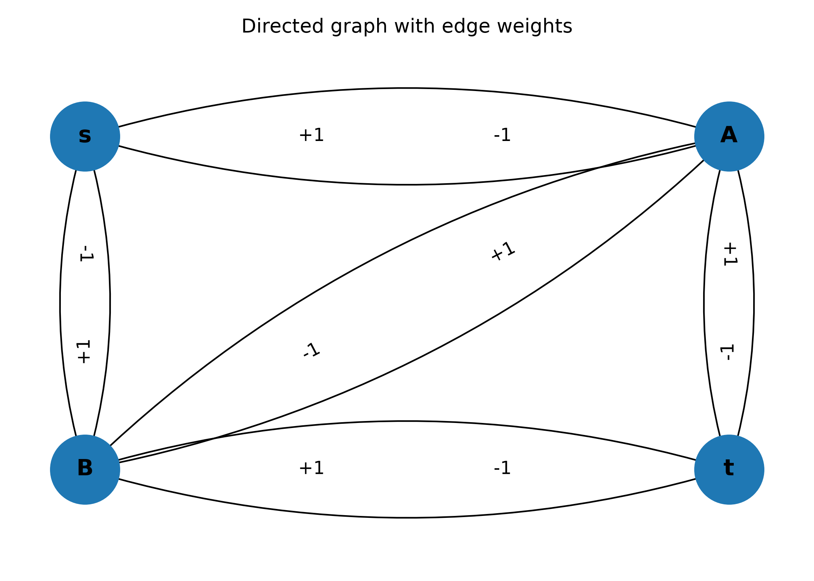

# Dijkstra vs. Bellman-Ford

A university project exploring shortest-path
algorithms in weighted graphs, with a focus
on the behavior of Dijkstra's algorithm in
the presence of negative edge weights.

The project includes Python implementations,
experimental comparisons with the Bellman-Ford
algorithm, and graph visualization.


## Project Overview

This project investigates shortest-path algorithms
in directed, weighted graphs, focusing on
Dijkstra's algorithm and its limitations when
negative edge weights are present.

The Python program generates 1,000 random graphs
with four vertices (`s`, `A`, `B`, `t`) and edge
weights of +1 or -1.

It runs Dijkstra's and Bellman-Ford's algorithms
from source vertex `s`, compares their calculated
distances, and reports the experimental results.

Bellman-Ford is also used to detect negative-weight
cycles reachable from the source.

In the original experiment, graphs containing
such cycles are counted as cases where Dijkstra
fails. These cases do not have well-defined finite
shortest-path distances for all affected vertices,
so the reported failure count should not be
interpreted as a strict accuracy measurement.

A separate visualization script illustrates a
directed graph with positive and negative
edge weights.


## Technologies Used

- Python 3
- `heapq` — Priority queue implementation
- `random` — Random graph generation
- `math` — Infinity representation
- NetworkX — Directed graph visualization
- Matplotlib — Graph plotting and image export


## Installation

### Prerequisites

- Python 3
- pip

### Setup

1. Clone the repository:

   ```bash
   git clone https://github.com/tsiligkaridoymaria-del/dijkstra-vs-bellman-ford.git
   ```

2. Navigate to the project directory:

   ```bash
   cd dijkstra-vs-bellman-ford
   ```

3. Install the required dependencies:

   ```bash
   python -m pip install -r requirements.txt
   ```
  
  
## Usage

### Run the algorithm comparison

```bash
python dijkstra.py
```

This script runs the experimental comparison
between Dijkstra's and Bellman-Ford's algorithms
and prints the results to the terminal.

### Generate the graph visualization

```bash
python graph.py
```

This script generates a visualization of a
directed weighted graph using NetworkX
and Matplotlib.

## Graph Visualization

The following figure illustrates a directed weighted graph used to demonstrate shortest-path algorithms.

